# Лабораторная работа № 6 «Система контроля версий»

## Содержание отчёта
1. [Цель работы](#цель-работы)
2. [Порядок выполнения лабораторной работы](#порядок-выполнения-лабораторной-работы)
3. [Ход выполнения лабораторной работы](#ход-выполнения-лабораторной-работы)
4. [Лог команд](#лог-команд)
5. [История операций в форматированном виде](#история-операций-в-форматированном-виде)
6. [Вывод](#вывод)

## Цель работы

Изучение базовых возможностей системы контроля версий Git, получение опыта работы с локальным и удалённым репозиториями и платформой GitHub.

## Порядок выполнения лабораторной работы

1. Создать аккаунт на сайте [GitHub](https://github.com/).
2. Сделать копию исходного репозитория [Kurtyanik/LR6](https://github.com/Kurtyanik/LR6/) в личном хранилище с помощью функции **Fork**.
3. Установить систему контроля версий Git с официального сайта [git-scm.com](https://git-scm.com/).
4. Настроить Git, указав имя пользователя в формате «Группа Фамилия И. О.» и адрес электронной почты.
5. Клонировать личный удалённый репозиторий на компьютер.
6. Добавить файл через интерфейс GitHub и получить изменения в локальном репозитории с помощью команды `git pull`. Дальнейшую работу выполнять локально.
7. Получить историю операций для каждой из веток.
8. Просмотреть последние изменения в репозитории.
9. Выполнить слияние веток в `master`, разрешив возникший конфликт.
10. Удалить побочную ветку после успешного слияния.
11. Несколько раз внести изменения в файлы и зафиксировать их с помощью коммитов, добавляя комментарии к каждому коммиту.
12. Выполнить откат одного из коммитов.
13. Создать отдельную ветку для работы над отчётом.
14. Начать оформление отчёта в файле `README.md` с использованием синтаксиса Markdown. Для редактирования разрешается использовать сторонние редакторы с подсветкой синтаксиса.
    - Добавить скриншоты консоли и используемых программ. Разместить изображения в отдельной папке.
    - Добавить лог команд без результатов их выполнения.
    - Периодически фиксировать изменения отчёта коммитами с комментариями.
15. Получить историю операций в форматированном виде: сокращённый хэш коммита, дата, имя автора и комментарий. Добавить её в отчёт и выполнить финальную фиксацию изменений.
16. Отправить локальные изменения в удалённый репозиторий на GitHub с помощью команды `git push`.

## Ход выполнения лабораторной работы

### 1. Создание аккаунта на сайте GitHub

Для выполнения лабораторной работы был создан личный аккаунт на платформе GitHub. Он необходим для хранения удалённого репозитория и работы с системой контроля версий.

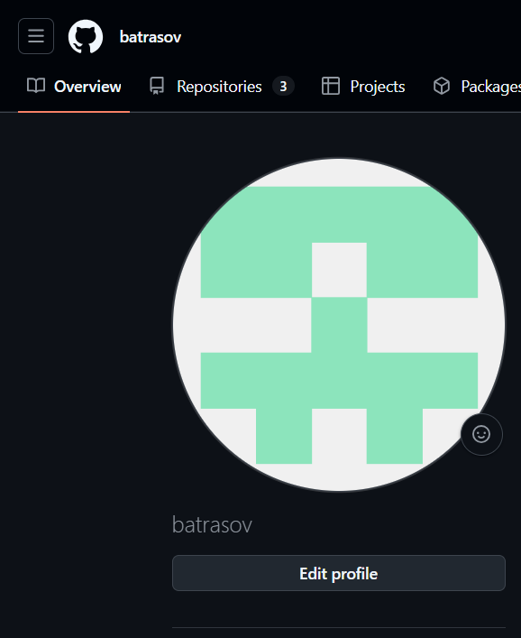  
Рисунок 1 – Аккаунт на GitHub

### 2. Создание копии репозитория (Fork)

На GitHub была создана личная копия исходного репозитория [Kurtyanik/LR6](https://github.com/Kurtyanik/LR6/) с помощью функции Fork. Копия находится в личном аккаунте и используется для выполнения лабораторной работы.

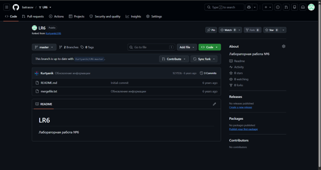  
Рисунок 2 – Личная копия репозитория на GitHub

### 3. Установка Git

Для работы с системой контроля версий Git была установлена программа с официального сайта [git-scm.com](https://git-scm.com/). После установки работоспособность программы была проверена с помощью команды `git --version`.

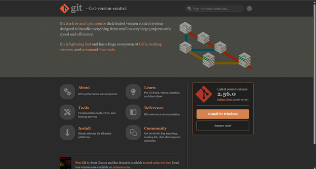  
Рисунок 3 – Официальный сайт для скачивания Git

### 4. Настройка Git

После установки программы были настроены имя пользователя и адрес электронной почты. Настройка выполнялась с помощью команды `git config`. Эти данные используются для указания автора изменений в истории коммитов.

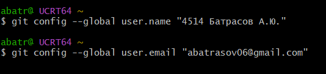  
Рисунок 4 – Настройка имени пользователя и электронной почты

### 5. Клонирование репозитория на компьютер

Личный удалённый репозиторий был склонирован на компьютер с помощью команды `git clone`. Локальная копия проекта находится в папке `Documents/GitHub/LR6` и связана с репозиторием на GitHub.

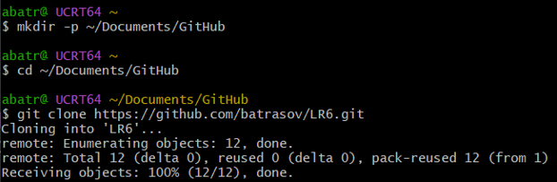  
Рисунок 5 – Локальная копия репозитория

### 6. Добавление файла через GitHub и получение изменений

Через веб-интерфейс GitHub был создан файл `new_file` с содержимым `РАНДОМ`. Затем команда `git pull` была использована для получения изменений из удалённого репозитория. После выполнения команды файл появился в локальной папке проекта.

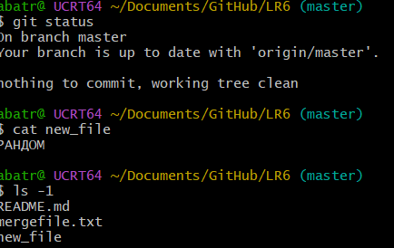  
Рисунок 6 – Проверка появления файла new_file в локальном репозитории

### 7. Получение истории операций для веток

Для просмотра истории операций использовалась команда `git log`. С её помощью просматривались коммиты и изменения, связанные с ветками репозитория.

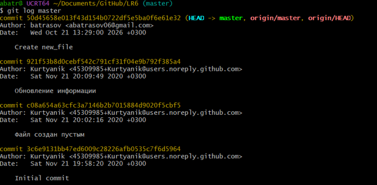  
Рисунок 7 – Просмотр истории операций в ветках

### 8. Просмотр последних изменений

Для просмотра последних изменений в репозитории использовались команды Git, позволяющие изучать историю коммитов и внесённые изменения. Это помогло проследить последовательность работы с файлами проекта.

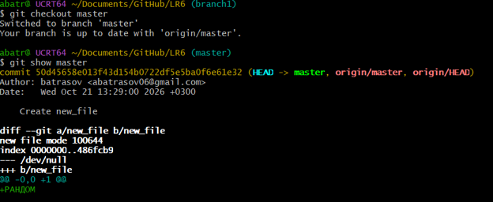  
Рисунок 8 – Просмотр последних изменений в репозитории

### 9. Слияние веток и разрешение конфликта

При слиянии веток был обнаружен конфликт в файле `mergefile.txt`. Для его разрешения файл был отредактирован вручную: служебные маркеры конфликта были удалены, а необходимое содержимое сохранено. После этого файл был добавлен в индекс и изменения были зафиксированы коммитом `Resolve merge conflict`.

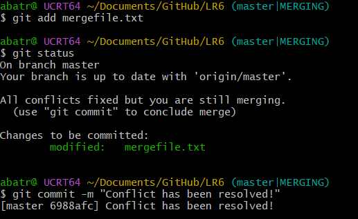  
Рисунок 9 – Разрешение конфликта при слиянии веток

### 10. Удаление побочной ветки

После успешного слияния была удалена побочная ветка `branch1`. Удаление было выполнено как в локальном репозитории, так и в удалённом репозитории GitHub.

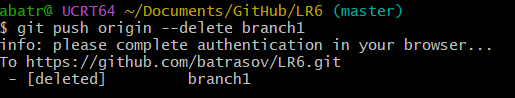  
Рисунок 10 – Удаление побочной ветки после слияния

### 11. Внесение изменений и создание коммитов

В файл `mergefile.txt` вносились дополнительные изменения. Для сохранения отдельных этапов работы использовались коммиты с комментариями, позволяющими определить содержание каждого изменения.

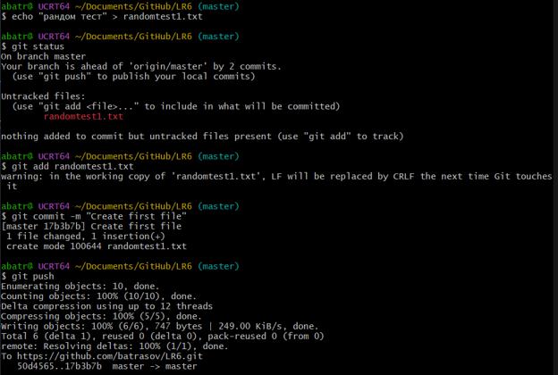  
Рисунок 11 – Фиксация изменений в репозитории

### 12. Откат коммита

Для выполнения отката использовалась возможность Git отменять ранее внесённые изменения. Операция позволяет вернуться к предыдущему состоянию файлов, сохраняя историю действий в репозитории.

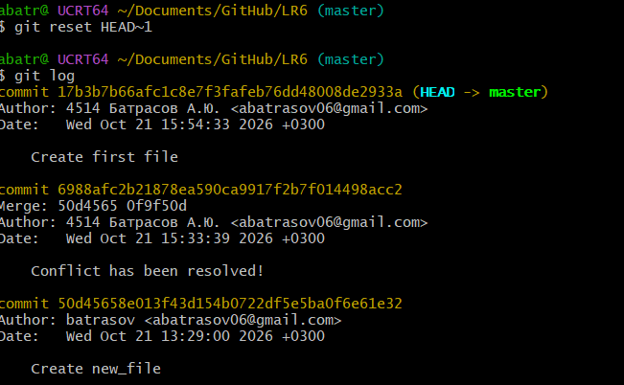  
Рисунок 12 – Откат коммита

### 13. Создание ветки для отчёта

Для оформления отчёта использовалась отдельная ветка `Report`. Это позволяет вести работу над отчётом отдельно от основной ветки проекта.

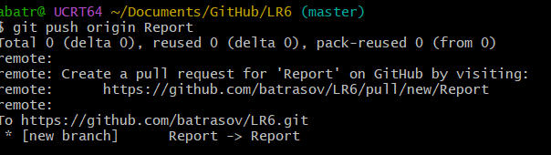  
Рисунок 13 – Создание и выбор ветки Report

### 14. Оформление отчёта в README.md

Отчёт оформлялся в файле `README.md` с использованием синтаксиса Markdown. Для подтверждения выполнения лабораторной работы были подготовлены рисунки, которые размещаются в отдельной папке `screenshots`. Также в отчёт добавляется лог команд без результатов их выполнения. Изменения отчёта сохраняются с помощью коммитов с комментариями.

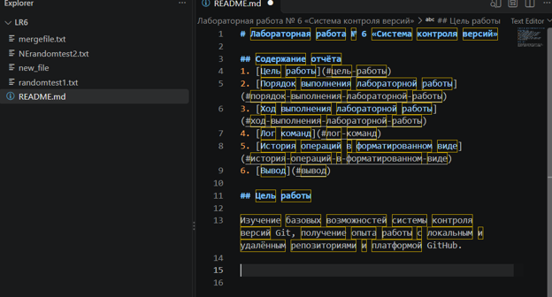  
Рисунок 14 – Оформление отчёта в файле README.md

### 15. Получение истории операций в форматированном виде

Для получения истории операций с сокращённым хэшем коммита, датой, именем автора и комментарием используется команда:

`git log --date=format:'%D' --pretty=format:"%h -> %cd, %cn ( %s )"`

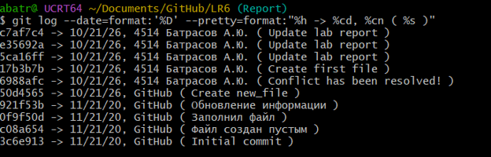  
Рисунок 15 – История операций в форматированном виде

### 16. Отправка изменений в удалённый репозиторий

После сохранения изменений локальные файлы были отправлены в удалённый репозиторий GitHub с помощью команды `git push`. Отправка отчёта выполнялась в ветку `Report`.

## Лог команд

В ходе выполнения лабораторной работы использовались следующие команды Git:

```bash
git config --global user.name "4514 Батрасов А.Ю."
git config --global user.email "abatrasov06@gmail.com"

git clone https://github.com/batrasov/LR6.git
git pull

git log master
git checkout branch1
git log branch1
git show branch1
git checkout master
git show master

git merge branch1
git diff
git add mergefile.txt
git commit -m "Conflict has been resolved!"

git branch -d branch1
git push origin --delete branch1
git branch -r

git add randomtest1.txt
git commit -m "Create first file"
git push

git add NErandomtest2.txt
git commit -m "Create second file"
git push

git log
git reset HEAD~1
git log

git branch Report
git branch
git push origin Report
git switch Report

git add README.md
git commit -m "Update lab report"
git push -u origin Report

git log --date=format:'%D' --pretty=format:"%h -> %cd, %cn ( %s )"

git add README.md screenshots/
git commit -m "Update lab report"
git push origin Report
```

## История операций в форматированном виде

Для получения истории коммитов с сокращённым хэшем, датой, именем автора и комментарием использовалась команда:

```bash
git log --all --pretty=format:"%h | %ad | %an | %s" --date=short
```

Результат выполнения команды:

```text
c7af7c4 -> 10/21/26, 4514 Батрасов А.Ю. ( Update lab report )
e35692a -> 10/21/26, 4514 Батрасов А.Ю. ( Update lab report )
5ca16ff -> 10/21/26, 4514 Батрасов А.Ю. ( Update lab report )
17b3b7b -> 10/21/26, 4514 Батрасов А.Ю. ( Create first file )
6988afc -> 10/21/26, 4514 Батрасов А.Ю. ( Conflict has been resolved! )
50d4565 -> 10/21/26, GitHub ( Create new_file )
921f53b -> 11/21/20, GitHub ( Обновление информации )
0f9f50d -> 11/21/20, GitHub ( Заполнил файл )
c08a654 -> 11/21/20, GitHub ( Файл создан пустым )
3c6e913 -> 11/21/20, GitHub ( Initial commit )

```

## Вывод

В ходе лабораторной работы я познакомился с основными возможностями системы контроля версий Git и платформы GitHub. Я научился создавать копию удалённого репозитория, клонировать его на компьютер, получать изменения, работать с ветками и разрешать конфликты при слиянии. Также я получил опыт фиксации изменений с помощью коммитов, ведения истории проекта и оформления отчёта в формате Markdown. Выполнение лабораторной работы помогло мне лучше понять принципы работы с локальными и удалёнными репозиториями.